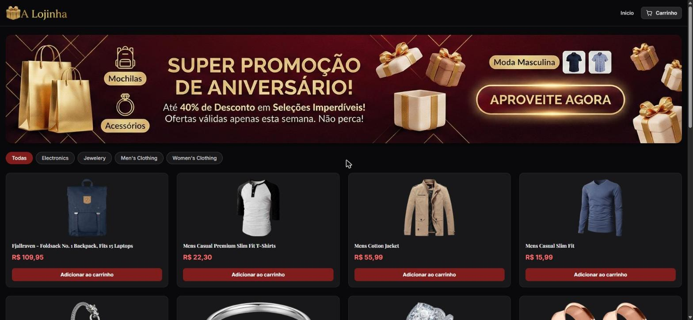

# Catálogo de Produtos

Aplicação web de catálogo de produtos ("A Lojinha") desenvolvida com React, TypeScript e
Tailwind CSS, consumindo produtos de uma API.

🔗 **Acesse:** [projeto-front-end-rust.vercel.app](https://projeto-front-end-rust.vercel.app)



## Funcionalidades

- Listagem de produtos na página inicial, com filtro por categoria
- Página de detalhes do produto
- Carrinho de compras
- Navegação entre páginas com React Router

## Tecnologias

- React 19
- TypeScript
- Tailwind CSS
- React Router DOM
- Vite

## Como rodar

```bash
npm install
npm run dev
```

## Imagens

Todas as imagens são provenientes da API ou foram geradas por IA (identificadas com o símbolo correspondente).

O código foi desenvolvido no VSCode, aproveitando as sugestões Inline do editor para aprimorar o projeto.